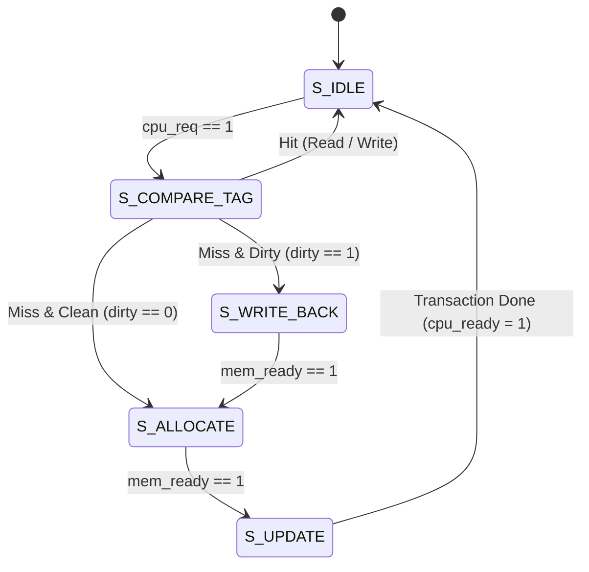

# Direct-Mapped Cache Controller: Architecture Specification

**Project Domain:** Computer Architecture / VLSI Design (Verilog HDL)  
**Author / Responsibility:** Member 1 (Cache Architecture & Verilog Design)

---

## 1. Architectural Overview

The proposed design implements a high-performance **4 KB Direct-Mapped Cache Controller** designed for a 32-bit RISC processor environment. The controller manages data transfers between a 32-bit CPU core and main memory, implementing a **Write-Back** with **Write-Allocate** policy to optimize bus utilization and minimize memory traffic.

### Key Architectural Specifications:
- **Cache Organization:** Direct-Mapped (1-way associative)
- **Total Data Capacity:** 4 KB (4096 Bytes)
- **Block / Line Size:** 16 Bytes (128 bits = 4 words of 32 bits each)
- **Total Lines / Sets:** 256 lines ($4096 / 16 = 256$)
- **Address Bus Width:** 32 bits (Byte addressable)
- **CPU Data Bus Width:** 32 bits
- **Memory Bus Width:** 128 bits (Line-wide block transfer)
- **Write Policy:** Write-Back (modified blocks are written to main memory only upon eviction)
- **Miss Allocation Policy:** Write-Allocate (fetch-on-write)
- **Status Bits per Line:** 1 Valid bit, 1 Dirty bit, 20 Tag bits

---

## 2. Memory Address Decomposition

For an incoming 32-bit CPU memory address `A[31:0]`:

$$\text{Address Width} = \text{Tag (20 bits)} + \text{Index (8 bits)} + \text{Word Offset (2 bits)} + \text{Byte Offset (2 bits)}$$

```
+-----------------------------------+--------------------+------------------+------------------+
|            Tag [31:12]            |    Index [11:4]    | Word Offset [3:2]| Byte Offset [1:0]|
|              20 bits              |       8 bits       |      2 bits      |      2 bits      |
+-----------------------------------+--------------------+------------------+------------------+
```

1. **Byte Offset (`A[1:0]`, 2 bits):** Identifies byte within a 32-bit word (assumes 32-bit aligned memory operations).
2. **Word Offset (`A[3:2]`, 2 bits):** Selects one of the four 32-bit words within a 16-byte cache line:
   - `2'b00`: Word 0 (`data_mem[31:0]`)
   - `2'b01`: Word 1 (`data_mem[63:32]`)
   - `2'b10`: Word 2 (`data_mem[95:64]`)
   - `2'b11`: Word 3 (`data_mem[127:96]`)
3. **Index (`A[11:4]`, 8 bits):** Directly addresses one of the 256 cache lines ($2^8 = 256$).
4. **Tag (`A[31:12]`, 20 bits):** Stored in the Tag RAM and compared against the incoming address to determine Hit/Miss.

---

## 3. Structural Datapath & Modular Hierarchy

The design is decomposed into three modular, synthesizable Verilog modules:

```
                          +------------------------------------------+
                          |             cache_controller             |
                          |      (FSM & Integration Controller)      |
                          +------------------------------------------+
                                       |                |
                +----------------------+                +----------------------+
                |                                                              |
                v                                                              v
+-------------------------------+                              +-------------------------------+
|       cache_tag_array         |                              |       cache_data_array        |
| - 256 x 20-bit Tag Array      |                              | - 256 x 128-bit Data SRAM     |
| - 256 x 1-bit Valid Bits      |                              | - Word Selection Multiplexer  |
| - 256 x 1-bit Dirty Bits      |                              | - Full-line Refill Port       |
| - Hit Detection Comparison    |                              | - Sub-word Write Update Port  |
+-------------------------------+                              +-------------------------------+
```

### Module Descriptions:
1. **`cache_tag_array.v`**:
   - Houses the Tag memory (`tag_mem`), Valid flags (`valid_mem`), and Dirty flags (`dirty_mem`).
   - Supports asynchronous line read for zero-latency tag evaluation and synchronous write enables.
2. **`cache_data_array.v`**:
   - Houses the 4 KB data storage (`data_mem`).
   - Supports line-level writes (`we_line`) for memory refills and word-level writes (`we_word`) for CPU writes.
3. **`cache_controller.v`**:
   - The master Finite State Machine (FSM) orchestrating handshakes with CPU and Main Memory.

---

## 4. Finite State Machine (FSM) Specification

The controller operates as a 5-state Mealy/Moore hybrid FSM:



### State Descriptions:
1. **`S_IDLE` (3'b000)**:
   - Waits for CPU memory access request (`cpu_req`).
   - Latches `cpu_addr`, `cpu_rw`, and `cpu_wdata`.
2. **`S_COMPARE_TAG` (3'b001)**:
   - Reads tag, valid, and dirty bits for `req_index`.
   - Compares stored tag with `req_tag`:
     - **Read Hit:** Returns `data_r_word` to `cpu_rdata`, asserts `cpu_ready = 1`, `cpu_hit = 1`, returns to `S_IDLE`.
     - **Write Hit:** Writes `latched_wdata` to target word in cache, sets `dirty = 1`, asserts `cpu_ready = 1`, `cpu_hit = 1`, returns to `S_IDLE`.
     - **Miss (Clean / Invalid):** Transitions to `S_ALLOCATE`.
     - **Miss (Dirty):** Latches eviction address `{stored_tag, req_index, 4'b0000}`, transitions to `S_WRITE_BACK`.
3. **`S_WRITE_BACK` (3'b010)**:
   - Drives `mem_req = 1`, `mem_rw = 1` (Write), `mem_addr = {evict_tag, req_index, 4'b0000}`, `mem_wdata = data_r_line`.
   - Stalls until `mem_ready == 1`, then transitions to `S_ALLOCATE`.
4. **`S_ALLOCATE` (3'b011)**:
   - Drives `mem_req = 1`, `mem_rw = 0` (Read), `mem_addr = {req_tag, req_index, 4'b0000}`.
   - Stalls until memory asserts `mem_ready == 1`.
   - On completion, loads `mem_rdata` into cache line, writes `req_tag`, sets `valid = 1`, transitions to `S_UPDATE`.
5. **`S_UPDATE` (3'b100)**:
   - For **Read Miss:** Delivers fetched word to `cpu_rdata`, clears `dirty = 0`, asserts `cpu_ready = 1`.
   - For **Write Miss (Write-Allocate):** Overwrites target word with `latched_wdata`, marks `dirty = 1`, asserts `cpu_ready = 1`.
   - Returns to `S_IDLE`.

---

## 5. Interface Signal Dictionary

### CPU Interface
| Signal Name | Direction | Width | Description |
|---|---|---|---|
| `clk` | Input | 1 bit | System clock |
| `rst_n` | Input | 1 bit | Active-low asynchronous reset |
| `cpu_req` | Input | 1 bit | CPU memory request strobe |
| `cpu_addr` | Input | 32 bits | CPU byte-addressable target address |
| `cpu_rw` | Input | 1 bit | Transaction type: `0` = Read, `1` = Write |
| `cpu_wdata` | Input | 32 bits | Data word to write into cache/memory |
| `cpu_rdata` | Output | 32 bits | Data word read from cache |
| `cpu_ready` | Output | 1 bit | High for 1 cycle when transaction finishes |
| `cpu_hit` | Output | 1 bit | High if access was a cache hit |

### Main Memory Interface
| Signal Name | Direction | Width | Description |
|---|---|---|---|
| `mem_req` | Output | 1 bit | Main memory operation request strobe |
| `mem_addr` | Output | 32 bits | 16-byte block aligned memory address |
| `mem_rw` | Output | 1 bit | Memory transaction: `0` = Read Block, `1` = Write Block |
| `mem_wdata` | Output | 128 bits | 16-byte block data for writeback eviction |
| `mem_rdata` | Input | 128 bits | 16-byte block data fetched from memory |
| `mem_ready` | Input | 1 bit | Main memory completion acknowledge strobe |

